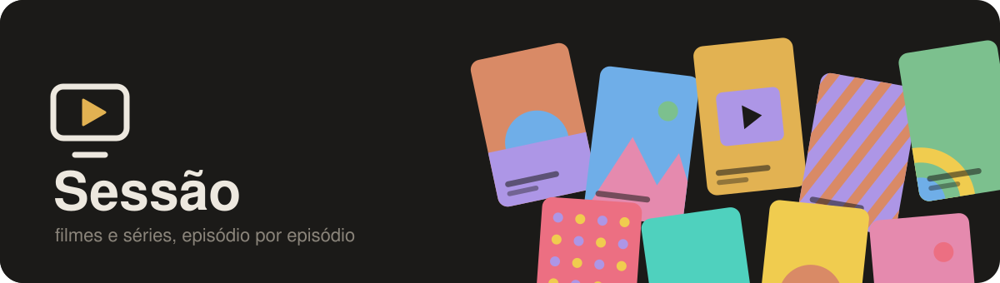
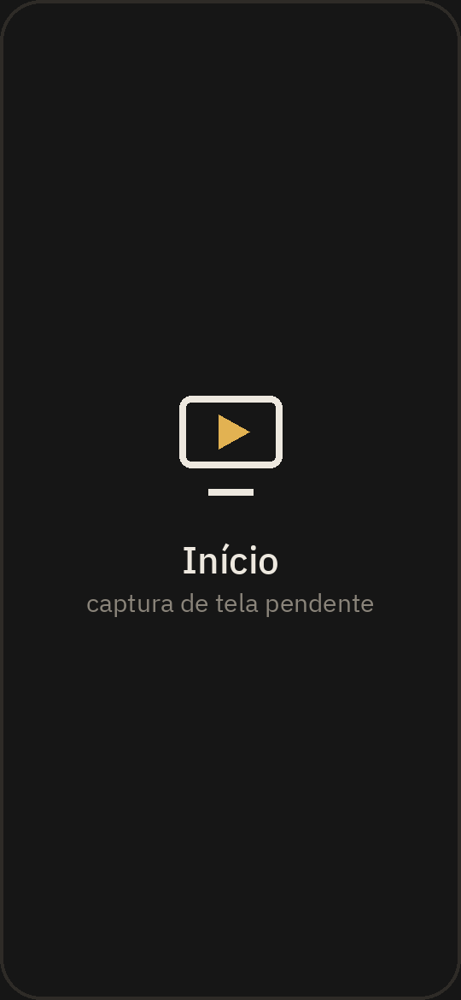
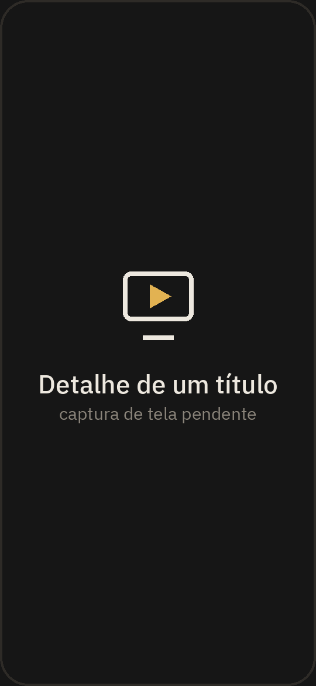
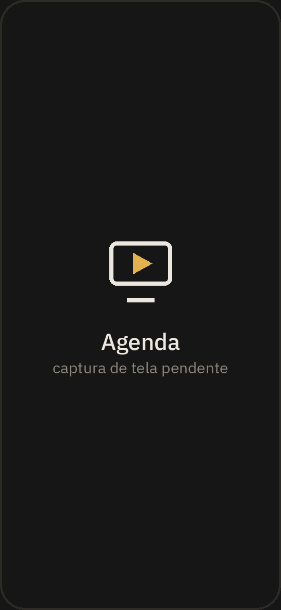
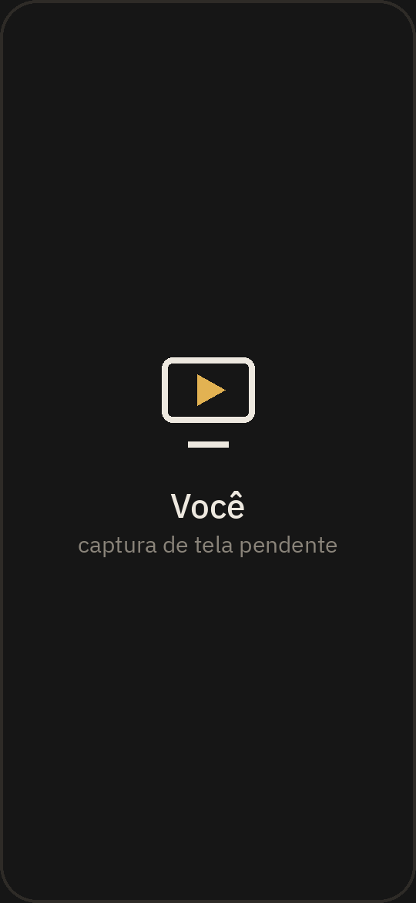
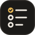
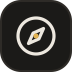
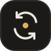
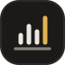
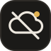

<h1>Sessão</h1>

<b>Sua watchlist de filmes e séries, no bolso.</b> 
O que você está vendo, em que episódio parou e onde dá para assistir no Brasil.

 

  
  
  
  

## Por que o Sessão

Entre uma série que voltou depois de um ano e um filme que alguém indicou, fica difícil lembrar em que episódio você parou e em qual serviço aquilo está. O Sessão guarda isso no celular: marca o episódio que acabou de ver num toque, avisa quando sai o próximo e mostra onde assistir no Brasil, com os seus serviços primeiro.

## O que ele faz

<table>
<tr>
<td width="80" align="center"></td>
<td><b>Acompanhe episódio por episódio</b> 
Um toque no +1 marca o próximo episódio e vira a temporada sozinho. Segurando o +1, você marca até um episódio específico. A série passa para <i>Em dia</i> quando você alcança o último lançado, volta para <i>Vendo</i> quando sai episódio novo e vai para <i>Terminado</i> quando acaba.</td>
</tr>
<tr>
<td align="center"></td>
<td><b>Notas do seu jeito</b> 
Letras (F, E, D, C, B, A e S, a nota máxima), 5 estrelas, carinhas coloridas (do vermelho de "Detestei" ao verde de "Adorei"), de 0 a 10 ou de 0 a 100. Dá para mostrar duas escalas ao mesmo tempo.</td>
</tr>
<tr>
<td align="center"></td>
<td><b>Agenda dos episódios</b> 
O que sai na semana, dia a dia, e o calendário do mês com o pôster em cada dia. Você escolhe entre a sua lista e tudo que está em exibição.</td>
</tr>
<tr>
<td align="center"></td>
<td><b>Onde assistir no Brasil</b> 
Assinatura, grátis, aluguel e compra, com os seus serviços primeiro. Tocar num serviço abre o app dele. E o Sessão avisa quando algo da sua lista chega num serviço que você assina.</td>
</tr>
<tr>
<td align="center"></td>
<td><b>Ache o próximo</b> 
Busca de filmes e séries, os destaques da semana, o Top 10, populares, estreias nos cinemas, o que está chegando ao streaming e o que tem nos seus serviços. Filtros por gênero e por serviço, e um botão que sorteia algo da sua lista Quero ver.</td>
</tr>
<tr>
<td align="center"></td>
<td><b>Trakt e Letterboxd</b> 
Entrando com a sua conta do Trakt, episódios e filmes vistos, notas e a lista Quero ver ficam iguais no Sessão e no Trakt, em qualquer aparelho. A aba Social mostra o que as pessoas que você segue estão vendo, com o perfil de cada uma: números, o que viu por último e as notas. 
E, com o seu nome de usuário do Letterboxd, os filmes que você registra lá entram aqui como vistos, com nota e data. Dá para importar o histórico inteiro e gerar um arquivo para levar o que você marcou aqui de volta para lá.</td>
</tr>
<tr>
<td align="center"></td>
<td><b>Seus números</b> 
Filmes, séries, episódios, tempo assistido, nota média e como as suas notas se distribuem, os gêneros que você mais vê e um histórico do que você terminou, mês a mês.</td>
</tr>
<tr>
<td align="center"></td>
<td><b>Do seu jeito</b> 
Tema claro, escuro ou preto, cor de destaque com o ícone combinando, e a ordem das categorias do Início. Cada título usa a cor do próprio pôster no progresso e na página dele.</td>
</tr>
<tr>
<td align="center"></td>
<td><b>Funciona sem internet</b> 
Tudo que está na sua lista abre sem conexão, com os pôsteres guardados. Só a busca e o Descobrir precisam de internet.</td>
</tr>
</table>

## Como instalar

1. Baixe o arquivo **SessãoMovies.apk** na [página de versões](https://github.com/Vicente-PIlonetto/SessaoMovies/releases/latest).
2. Abra o arquivo no celular. Se o Android pedir, permita **instalar apps desconhecidos** para o navegador ou para o app de arquivos.
3. Abra o Sessão. Não tem login: tudo fica no seu celular.

Para atualizar, baixe a versão nova e instale por cima. Sua lista, notas e configurações continuam lá.

## Primeiros passos

- **Marque os seus serviços de streaming** no aviso da primeira abertura ou em *Você > Configurações > Meus serviços de streaming*. Eles aparecem primeiro em "Onde assistir" e filtram o Descobrir.
- **Busque um título** pela lupa do Início e toque em *Adicionar*.
- **Ligue os avisos** em *Configurações > Notificações* para saber quando sai episódio novo ou quando algo da lista chega num serviço seu.
- **Chave do TMDB**: o APK já vem com uma. Se ela parar de funcionar, ou se você compilou o app por conta própria, crie uma de graça em [themoviedb.org](https://www.themoviedb.org/settings/api) (conta gratuita, *Configurações > API*, pedido de uso pessoal) e cole em *Configurações > Chave do TMDB*. Serve a chave da API (v3) ou o token de leitura.
- **Trakt**: em *Configurações > Trakt*, toque em *Entrar no Trakt*, abra trakt.tv/activate e digite o código que aparece. A sincronização roda uma vez por dia e quando você puxa o Início.
- **Letterboxd**: em *Configurações > Letterboxd*, coloque o seu nome de usuário e ligue *Sincronizar*. Para trazer o histórico inteiro, exporte os seus dados no site do Letterboxd (*Settings > Data > Export your data*) e importe o .zip no Sessão.

## Perguntas frequentes

**Preciso de conta?**
Não. O Sessão não tem servidor próprio: os dados ficam no celular e podem ser salvos num backup em *Configurações > Backup*. A conta do Trakt é opcional, para sincronizar entre aparelhos.

**Por que o Letterboxd não sincroniza nos dois sentidos?**
O Letterboxd não libera a API dele para projetos pessoais. Então o Sessão usa só o que é público: o feed do seu perfil (para trazer o que você registra lá) e os arquivos de importação e exportação do próprio Letterboxd. Para mandar o que você marcou no Sessão, gere o CSV em *Configurações > Letterboxd* e envie em letterboxd.com/import.

**Por que "Onde assistir" às vezes não bate com o serviço?**
Os dados vêm do JustWatch, pelo TMDB, e são atualizados uma vez por dia no app. Quando um título entra ou sai de um catálogo, pode levar um ou dois dias para aparecer.

**Tem anime?**
Animes aparecem como qualquer outra série do TMDB. Não há nada específico para eles.

**Por que não está na Play Store?**
É um projeto pessoal e gratuito. A instalação é pelo arquivo, como descrito acima.

## Privacidade

O Sessão conversa com o TMDB (dados de filmes e séries, e onde assistir) e, se você ligar, com o Trakt (a sua conta, para sincronizar) e com o feed público do seu perfil no Letterboxd. O acesso ao Trakt fica guardado cifrado no celular. Não há anúncios, contas nem coleta de dados. A sua lista, as notas e os episódios marcados ficam só no celular.

## Encontrou um problema ou tem uma ideia?

Abra uma [issue](https://github.com/Vicente-PIlonetto/SessaoMovies/issues/new/choose): há modelos para relatar um erro ou sugerir uma ideia. Quer ajudar com código? Veja o [guia de contribuição](CONTRIBUTING.md).

## Licença

Distribuído sob a [GNU GPL 3.0](LICENSE). Você pode usar, estudar, modificar e compartilhar; versões modificadas que forem distribuídas também precisam ter o código aberto.

 
Dados de filmes e séries do <a href="https://www.themoviedb.org">TMDB</a>. Este app usa a API do TMDB, mas não é endossado nem certificado pelo TMDB. 
Dados de streaming: <a href="https://www.justwatch.com/br">JustWatch</a>. 
O Sessão não é afiliado ao TMDB, ao Trakt nem ao Letterboxd. 
Fontes IBM Plex Sans e IBM Plex Mono, sob a SIL Open Font License.

